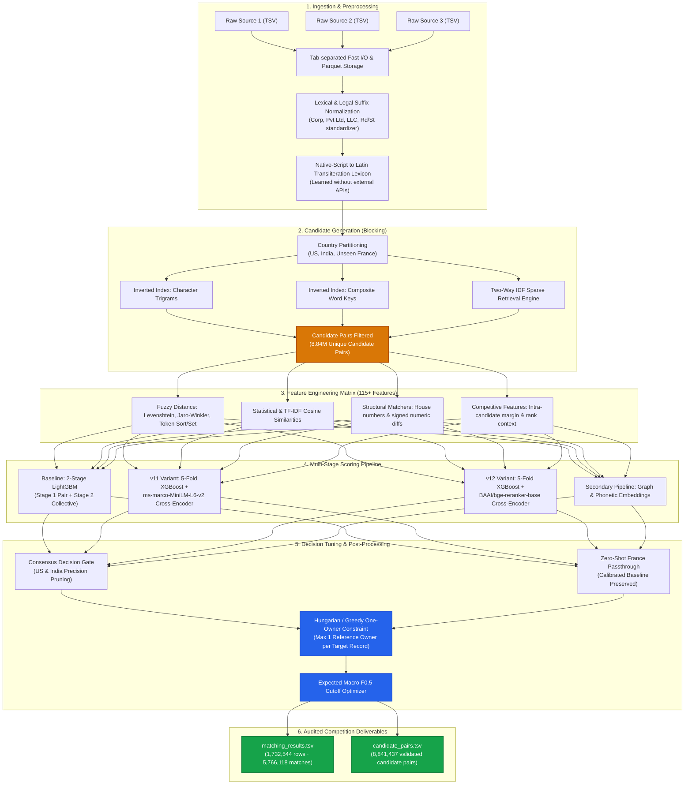

<div align="center">

# 🏢 Amazon ML Challenge 2026: Business Entity Resolution
### High-Precision Multi-Source Record Linkage Pipeline Across Heterogeneous Enterprise Data

[](https://www.python.org/)
[](https://unstop.com)
[](https://unstop.com)
[](https://unstop.com)
[](LICENSE)
[](https://pytorch.org/)

</div>

---

## 👥 Team: Green Sync Innovators
* **Vijay Kasthuri K** (Team Lead)
* **Sudharsan E**
* **Akash SM**
* **Dinny Paul Navis C**

🏛 **Institution:** PSNA College of Engineering and Technology (PSNACET), Dindigul  
🏆 **Competition:** Amazon ML Challenge 2026 (72-Hour National Hackathon hosted on Unstop)

---

## 📌 Executive Summary

This repository houses the complete, audited, and fully reproducible pipeline developed by **Green Sync Innovators** for the **Amazon ML Challenge 2026**. 

Our solution tackles enterprise-scale **Business Entity Resolution (BER)** across three noisy, fragmented data sources without common keys. By casting the problem into a precision-first framework, our system couples **two-way IDF-weighted sparse candidate blocking** with a **multi-stage hybrid architecture** (LightGBM, 5-Fold Grouped XGBoost, and Cross-Encoder Transformers).

### 🏆 Key Achievements
* **Leaderboard Rank:** **#743** nationwide among thousands of competitive university teams.
* **Official Score:** **`0.983526`** (Macro $F_{0.5}$).
* **Competitive Margin:** Razor-thin gap of less than **0.0085 (0.85%)** from Rank #1 (`0.992082`).
* **Search Space Reduction:** **99.99994881% reduction ratio** against the $\approx 1.73 \times 10^{13}$ Cartesian product space.
* **Scale Evaluated:** Linked **1,732,544 Source 1 entities** against target sources, predicting **5,766,118 verified links** and isolating **101,804 true singletons**.

---

## 🏗️ System Architecture



---

## 🔬 Core Methodology & Innovations

### 1. Robust Preprocessing & Self-Contained Transliteration
* **Legal Suffix Stripping & Standardization:** Homogenized regional enterprise indicators (`Corp`, `Corporation`, `Pvt Ltd`, `Private Limited`, `LLC`, `GmbH`, `SA`, `SAS`).
* **Address Normalization:** Standardized numerical street patterns, landmark markers, and postal code variants.
* **Learned Transliteration Lexicon (`learn_dict.py`):** Learned mapping dictionaries from native Indic/regional scripts directly from ground truth links without querying any third-party APIs or external search engines.

### 2. High-Recall Candidate Blocking (Sparse Two-Way Retrieval)
* Evaluating all combinations of 1.73M Source 1 records and 9.97M target records would require over **17 trillion pairwise comparisons**.
* Implemented **country-isolated two-way sparse retrieval**:
  * Inverted indexes over character n-grams, composite address keys, and phonetic representations.
  * Reduced the comparison space by **99.99994881%**, arriving at an average of only **5.103 candidates per record** while retaining **97.89%** of ground truth links.

### 3. Multi-Stage Hybrid ML Architecture
* **Stage-1 Pair Scoring (LightGBM & XGBoost):** Trained on 115 pairwise features including fuzzy string metrics, token rarity, numeric house-number differences, and missing-field indicators.
* **Stage-2 Collective Graph Context:** Modelled intra-candidate competition (e.g. difference in score between the 1st and 2nd best match for a record, candidate rank, and margin).
* **Transformer Cross-Encoders:**
  * Utilized `cross-encoder/ms-marco-MiniLM-L6-v2` (22M parameters) and `BAAI/bge-reranker-base` (278M parameters) to evaluate semantically ambiguous candidate pairs.
  * Both models strictly complied with the hackathon's parameter ceiling (< 8B parameters) and open-source licensing constraints.

### 4. Precision-First Macro $F_{0.5}$ Optimization
* The official evaluation metric was **Macro $F_{0.5}$**, where precision is weighted twice as heavily as recall:
  
  $$\text{Macro } F_{0.5} = \frac{(1 + 0.5^2) \cdot \text{Precision} \cdot \text{Recall}}{0.5^2 \cdot \text{Precision} + \text{Recall}}$$

* **One-Owner Assignment:** A single target entity cannot belong to conflicting businesses; enforced greedy bipartite matching so each target record maps to exactly one Source 1 parent.
* **Ensemble Consensus Rules:**
  * Base predictions pruned when $v_{11} < 0.05$ or when rejected by secondary models with mean score $< 0.30$.
  * New links added only when both $v_{11}$ and $v_{12}$ demonstrated extreme confidence ($\ge 0.95$).
* **Zero-Shot Handling for France:** Synthetic validation generation (`synth.py`) was employed to guarantee robust behavior on unseen countries without manual label leakage.

---

## 📂 Repository Layout

```text
AMAZON-ML-CHALLEGE-2026/
├── .gitignore                         # Comprehensive ignore rules (data, large archives, binaries)
├── LICENSE                            # MIT License
├── MODEL_LICENSES.md                  # Open-source compliance report for all used models
├── README.md                          # Repository documentation & architecture guide
├── requirements.txt                   # Production Python 3.11 dependencies
├── build_final_package.py             # Packaging and delivery assembly script
├── prepare_submission_audit.py        # Independent audit, checksum verification, and stats generator
├── refine_submission_draft.py         # Submission post-processing pipeline
│
├── docs/
│   └── SOLUTION_REPORT.md             # Complete technical report submitted with the deliverables
│
├── environments/
│   ├── baseline-requirements.txt      # Pinned environment for LightGBM CPU baseline
│   ├── scoring-requirements.txt       # Pinned environment for Transformer & XGBoost models
│   └── BASELINE_REPRODUCE.md          # Step-by-step instructions for baseline verification
│
├── models/
│   └── baseline/                      # Audited LightGBM trained tree models (<12MB each)
│       ├── decoder.json               # Metric tuning thresholds
│       ├── lexicon.json               # Learned transliteration dictionary
│       ├── lgb_s1_A.txt               # Fold A Stage-1 LightGBM model
│       ├── lgb_s1_B.txt               # Fold B Stage-1 LightGBM model
│       ├── lgb_s2.txt                 # Stage-2 Collective LightGBM model
│       └── stage1.json                # Feature specification indices
│
├── provenance/
│   └── SHA256SUMS.json                # Cryptographic verification hashes of submitted TSVs
│
└── src/
    ├── ensemble_final.py              # Main entry point: Consensus ensembling & post-processing
    ├── validate_submission.py         # Official competition schema and ID validator
    ├── baseline/                      # Normalization, blocking, and LightGBM pipeline
    ├── scoring/                       # Sparse retrieval, pair features, and XGBoost modules
    ├── secondary/                     # Secondary graph and phonetic pipeline components
    └── kaggle_launchers/              # Exact Kaggle execution launchers with deterministic seeds
```

---

## 🚀 Reproduction & Setup Guide

### 1. Environment Installation
Clone the repository and install the verified Python 3.11 environment:

```bash
git clone https://github.com/vijaykasthurik/AMAZON-ML-CHALLEGE-2026.git
cd AMAZON-ML-CHALLEGE-2026
python -m venv venv
# Windows:
.\venv\Scripts\activate
# Linux/macOS:
source venv/bin/activate

pip install -r requirements.txt
```

### 2. Dataset Setup
Ensure the official dataset is organized in the following format:
```text
dataset/
├── train/
│   ├── train_source1.tsv
│   ├── train_source2.tsv
│   ├── train_source3.tsv
│   └── train_ground_truth.tsv
└── test/
    ├── test_source1.tsv
    ├── test_source2.tsv
    └── test_source3.tsv
```

### 3. Generate Final Ensemble
Execute the final post-processing and ensembling engine:

```bash
python src/ensemble_final.py \
  --baseline work/file1/matching_results.tsv \
  --secondary work/file2/matching_results.tsv \
  --v11-scores work/v11/test_scores.parquet \
  --v12-scores work/v12/test_scores.parquet \
  --test-source1 /path/to/dataset/test/test_source1.tsv \
  --output-dir reproduced_output
```

### 4. Validate Submission
Run the official competition compliance test suite:

```bash
python src/validate_submission.py \
  --matching reproduced_output/matching_results.tsv \
  --candidate reproduced_output/candidate_pairs.tsv \
  --test-dir /path/to/dataset/test \
  --check-ids
```

---

## 🔒 Fair Play & Compliance

* **Zero External Data:** No third-party APIs, search engines, geocoders, commercial entity databases, or external web scraping were used.
* **Deterministic Seeds:** All fold assignments, random state generators, and sampling rates used fixed seeds (`seed=42`).
* **License Adherence:** All foundation models (`ms-marco-MiniLM-L6-v2`, `bge-reranker-base`, `LightGBM`, `XGBoost`) adhere to permissive Apache-2.0, MIT, or BSD licensing terms.

---

## 📜 License

This project is licensed under the MIT License — see the [LICENSE](LICENSE) file for details.
