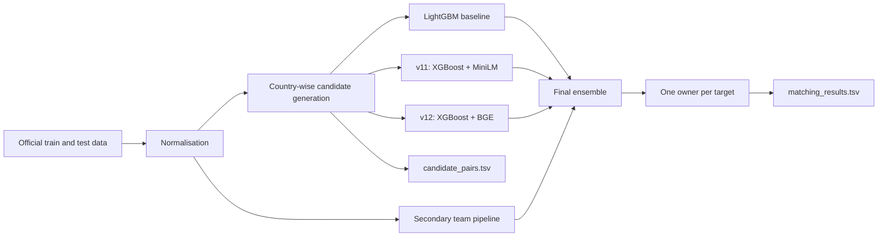

# ML Challenge 2026: Business Entity Resolution

**Team Name:** Green Sync Innovators  
**Team Members:** Vijay Kasthuri K, Sudharsan E, Akash SM, Dinny Paul Navis C  
**Submission Date:** 29 September 2026

## 1. Executive Summary

We treated the task as a precision-first entity-resolution problem. Our system
first generated a small set of plausible cross-source pairs, then scored each
pair with complementary tree and text models. The final submission began with
our strongest two-stage LightGBM result, used two independent score variants to
make conservative changes for US and India, and retained the baseline result for
France, where labelled training examples were unavailable.

## 2. Methodology

### 2.1 Problem analysis

The same business appears with different legal suffixes, abbreviations, spelling,
word order and address formatting. Indian records also contain cross-script and
transliteration variation. Addresses may be incomplete, and unrelated businesses
can share a commercial building. These patterns make exact matching unreliable.

The evaluation metric is macro F0.5. A false merge is more expensive than a
missed link, and a correct empty prediction receives full credit for a singleton.
We therefore tuned the candidate budget and the decision rules for high precision
while retaining multiple links when the evidence was consistent.

### 2.2 Solution strategy

Our pipeline has four stages:

1. Normalise business names and addresses.
2. Generate candidates independently within each country.
3. Score candidate pairs with engineered features, gradient-boosted trees and
   two cross-encoder variants.
4. Apply a one-owner constraint and precision-oriented ensemble rules.

## 3. Candidate Generation / Blocking

Candidate generation was performed separately by country, so records from
different countries were never compared. The baseline used two TF-IDF inverted
indexes: character trigrams and composite word keys. Its keys included phonetic
or normalised name forms, name-word combinations, address words, house numbers,
and combinations such as number plus street or name token. Forward and reverse
retrieval helped recover cases where one side was short or noisy.

The v11/v12 pipeline used two-way sparse retrieval with IDF-weighted typed tokens:
name tokens, glued phonetic names, address words, address numbers and composite
name/address/number keys. A learned first-stage score pruned the retrieval output
before the more expensive model stages.

The submitted candidate file contains 8,841,437 unique pairs for 1,732,544 Source
1 rows, an average of 5.103 candidates per row. It is the exact union of 8,806,261
v11-scored pairs and 35,176 final selected pairs outside that set. All 5,766,118
final matches occur in the candidate file. Against the unrestricted Cartesian
product of 1,732,544 Source 1 records and 9,969,589 target records, the arithmetic
reduction ratio is 99.99994881%; this denominator includes cross-country pairs.

## 4. Model Architecture and Feature Engineering

### Baseline model

The baseline used two stage-1 LightGBM fold models followed by a stage-2 LightGBM
model. Stage 1 used 115 features covering:

- fuzzy name and address similarity;
- character and token agreement;
- word-alignment statistics;
- house-number agreement and signed numeric differences;
- legal-form and acronym consistency;
- missing-field indicators;
- token rarity and retrieval ranks;
- competition between candidates for the same record.

Stage 2 used 36 features. It combined the first-stage probability with rank,
margin and graph-context features. The selected decoder maximised an
expected-F0.5 approximation after enforcing one target owner.

### Score variants

The v11 and v12 variants used five-fold XGBoost pair models and a second collective
stage. The collective features describe how a pair compares with competing pairs
for the same Source 1 or target record. A cross-encoder supplied an additional
joint text score for uncertain pairs. v11 used
`cross-encoder/ms-marco-MiniLM-L6-v2`; v12 used `BAAI/bge-reranker-base`.
Both checkpoints comply with the stated model-size and license constraints.

### Final ensemble

The final result used the following fixed rules:

1. Start with the baseline prediction.
2. For US and India, remove a pair when v11 is below 0.05.
3. Remove a pair rejected by the secondary prediction when the mean of v11 and
   v12 is below 0.30.
4. Add a secondary pair only when both v11 and v12 are at least 0.95.
5. Assign every added target to one Source 1 owner.
6. Leave France exactly as predicted by the baseline.

Relative to the baseline, this changed 6,119 US rows and 7,151 India rows. It
added 1,826 and removed 4,570 US links, and added 2,864 and removed 4,489 India
links. France had zero changes.

## 5. Results and Error Analysis

The submitted leaderboard score was **0.983526**, with rank **743** in the supplied
result screenshot. The packaged output contains 1,732,544 rows, 5,766,118 matched
IDs and 101,804 predicted singletons. Both TSV files passed the organizer’s
format, coverage, containment and ID-existence checks.

The baseline’s recorded 4% holdout contained 88,408 Source 1 entities. Its exact
macro F0.5 was 0.986527 after stage 1 and 0.987442 after stage 2. Its model-candidate
blocking recall on training links was recorded as 97.89%. These values describe
the baseline validation run; they are not test-set labels or leaderboard estimates.

The most difficult errors came from three patterns: businesses with nearly
identical names at a shared address, heavy truncation on both fields, and numeric
address conflicts hidden by otherwise strong text similarity. The conservative
ensemble rules were introduced to reduce these false merges. Cross-script names
and French records remained the main sources of uncertainty.

## 6. Fair Play and Reproducibility

We used only the supplied challenge records and labels. We did not query business
registries, geocoders, search engines, commercial resolution APIs, or external
identity databases. The learned transliteration lexicon was derived from the
provided training links. Source, saved models, run settings, pinned environments,
output hashes and validation commands are included in the ZIP.

## 7. Conclusion

Our result combines broad but economical blocking with models designed around
the precision-heavy evaluation metric. The strongest improvements came from
numeric-conflict features, candidate competition, one-owner decoding and requiring
agreement between independent score variants before adding a new link.

## Appendix: Code Artifacts

The entry point for the final combination is `src/ensemble_final.py`. Component
source is grouped under `src/baseline/`, `src/scoring/` and `src/secondary/`.
`README.md` gives the run order, environment setup, validation command and expected
hashes. The final outputs are under `output/` with the exact required names.
